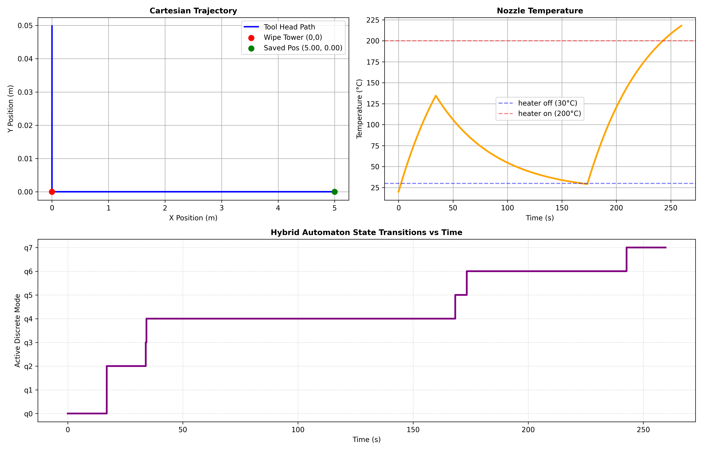

# 3D Printer Dynamic & Thermal Modeling

Python simulations of a CoreXY 3D printer, developed as part of a physical modeling project.

## Q1.4
# Motion Dynamics and Trajectory Simulation
Modeling of the mechanical and electrical dynamics of a CoreXY printer driven by two motors, based on two decoupled x- and y-axis state-space descriptions. Input motor voltages are designed to generate elliptical and Lissajous trajectories. 


## Q1.6
# Filament Thermal Simulation
Modeling of temperature evolution of a filament being deposited along a circular path, using a 1D heat equation. The model accounts for heat conduction between filament segments, heat exchange with the heated print bed and convection with ambient air. A finite-difference discretization and numerical ODE integration are used to simulate the deposition and cooling of filament, until a nearly uniform temperature is reached.


# 3D Printer Hybrid System Simulation

This repository contains a Python-based simulation for a 3D printer modeled as a hybrid automaton. The project integrates continuous physical dynamics with discrete supervisory logic to accurately model mechanical motion, electrical circuits, and thermal properties during a print interruption and recovery cycle.

## System Architecture

The simulation is driven by a 10-dimensional continuous vector field and bounded by discrete event guards using `scipy.integrate.solve_ivp`.

* **Continuous Dynamics (10D State Space):** Models DC motor positions, velocities, and currents, alongside the nozzle's RLC circuit, thermal temperature, and an integrated odometer to track filament usage and spatial displacement.
* Finite State Machine:
  * **`q0`**: head is moving moving forward.
  * **`q1`**: save the current X and Y coordinates.
  * **`q2`**: head returning to the wipe tower at the origin.
  * **`q3`**: Scrubbing and wiping sequence at the origin.
  * **`q4`**: Thermal cooling phase targeting a safe threshold of 30°C.
  * **`q5`**: 5-second filament loading delay.
  * **`q6`**: Thermal heating phase targeting an operational threshold of 200°C.
  * **`q7`**: return to the saved X and Y print coordinates.

## Dependencies

The simulation requires standard scientific Python libraries:
* `numpy`
* `scipy`
* `matplotlib`

## Usage

Execute the main simulation script from the terminal:

```bash
python3 hybrid_system.py
```

The script will output timestamped discrete event triggers to the console and generate a comprehensive `matplotlib` figure containing the trajectory and state data.

## Simulation Results




The generated output successfully demonstrates the complete hybrid cycle:
* **Cartesian Trajectory:** Shows the precise path tracking the tool head from the origin, stopping at the saved position (5.00, 0.00), reversing to the Wipe Tower, and returning to the saved position.
* **Nozzle Temperature:** Validates the cooling curve down to 30°C and the heating curve past 200°C.
* **FSM Transitions:** Confirms the strict chronological progression of the 8 discrete modes (q0 through q7) against the master simulation clock.
