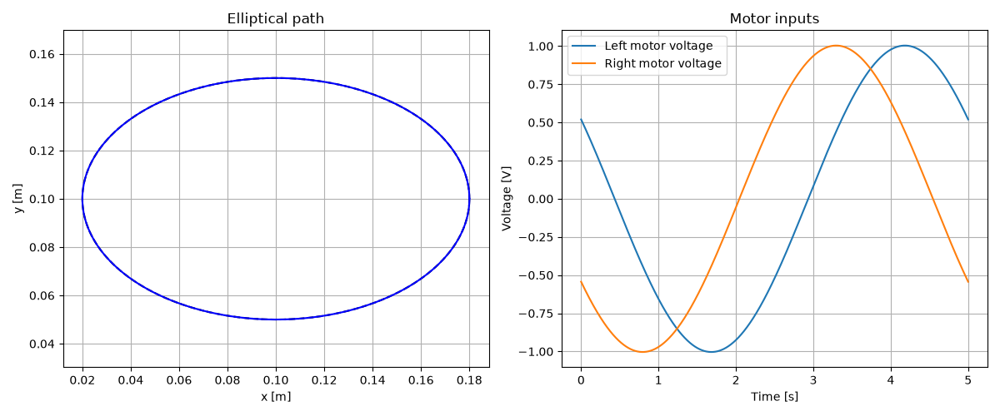
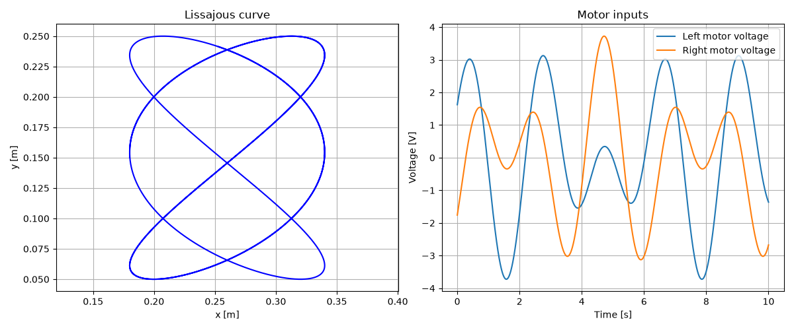
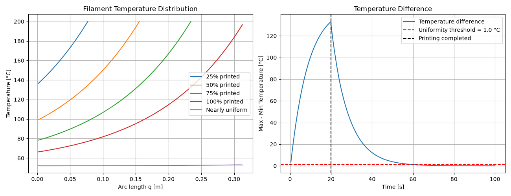
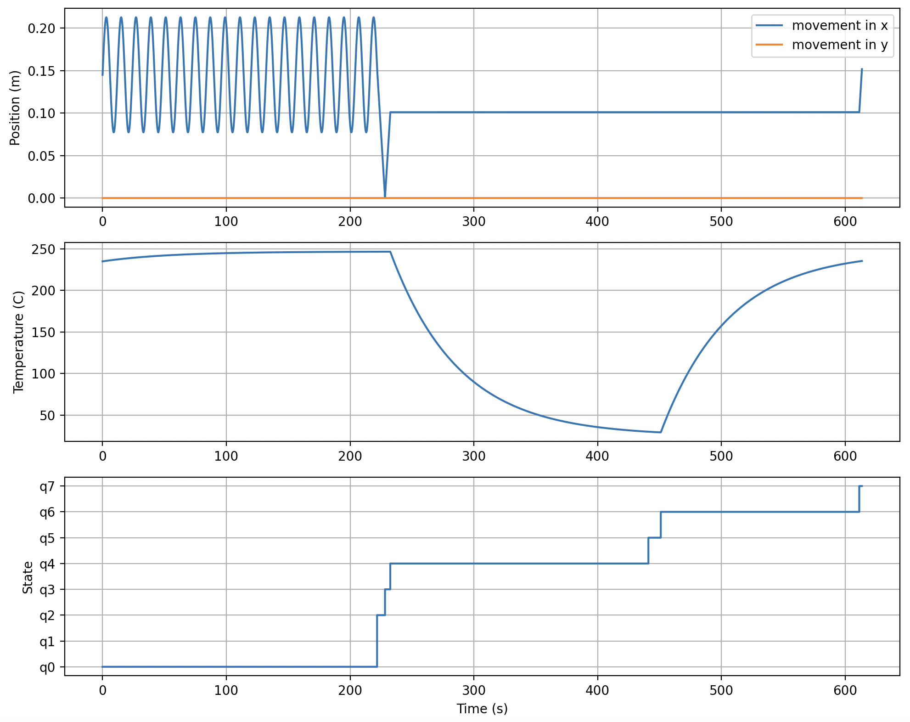
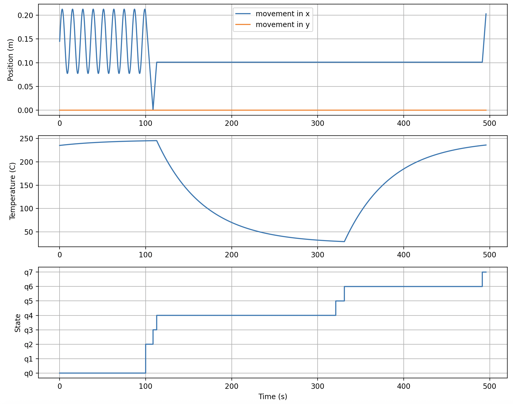
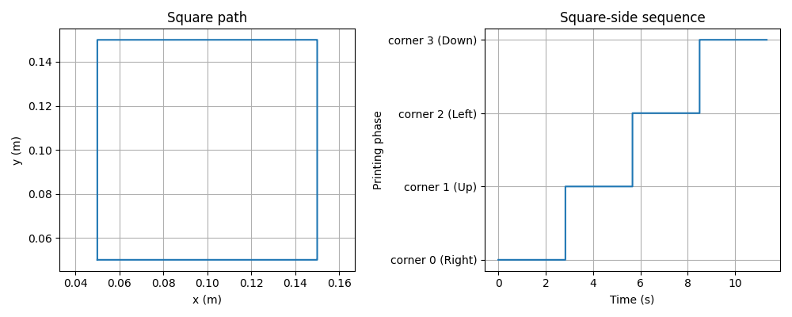

# Modelling a 3D printer
Python simulations of a CoreXY 3D printer, developed as part of a physical modeling project.

## Q1.4 - Motion Dynamics and Trajectory Simulation
Modeling of the mechanical and electrical dynamics of a CoreXY printer driven by two motors, based on two decoupled x- and y-axis state-space descriptions. Input motor voltages are designed to generate elliptical and Lissajous trajectories. 




## Q1.6 - Filament Thermal Simulation
Modeling of temperature evolution of a filament being deposited along a circular path, using a 1D heat equation. The model accounts for heat conduction between filament segments, heat exchange with the heated print bed and convection with ambient air. A finite-difference discretization and numerical ODE integration are used to simulate the deposition and cooling of filament, until a nearly uniform temperature is reached.



## Q3.1 - 3D Printer Hybrid System Simulation

This repository contains a Python-based simulation for a 3D printer modeled as a hybrid automaton. The project integrates continuous physical dynamics with discrete supervisory logic to accurately model mechanical motion, electrical circuits, and thermal properties during a print interruption and recovery cycle.

### System Architecture

The simulation combines a 10-dimensional continuous model with a finite state machine. It uses `scipy.integrate.solve_ivp` to integrate the dynamics and detect events that trigger mode transitions and state resets.

### Continuous Dynamics

The state vector contains:

- Two motor angles.
- Two motor angular velocities.
- Two motor currents.
- Nozzle inductor current and capacitor voltage.
- Nozzle temperature.
- An odometer measuring accumulated printing or wiping path length.

The saved print coordinates and loading timer are managed separately.

### Finite State Machine

| State | Operation |
|-------|-----------|
| `q0` | **Printing:** Moves back and forth along the x-axis using equal cosine motor voltages. The Replacement of filament starts when the printing distance reaches 5 m or a colour change is requested. |
| `q1` | **Save position:** Instantly stores the current x and y coordinates. |
| `q2` | **Move to origin:** Travels to the wipe-tower location at (0, 0). |
| `q3` | **Wiping:** Performs a 0.10 m wiping stroke starting near the origin. |
| `q4` | **Cooling:** Switches off the input voltage of the nozzle and waits until the temperature of nozzle reaches 30°C. |
| `q5` | **Loading:** Waits 10 seconds for filament loading while the nozzle continues cooling. |
| `q6` | **Heating:** Applies 14.2 V to the nozzle until the the temperature of the nozzle reaches 235°C. |
| `q7` | **Return:** Moves back to within 1 mm of the saved printing position. |

Both replacement triggers follow the same sequence :

`q0 → q1 → q2 → q3 → q4 → q5 → q6 → q7`

The model allows printing to resume through `q7 → q0`. The single-cycle demonstration stops after the return.

## Dependencies

The simulation requires standard scientific Python libraries:
* `numpy`
* `scipy`
* `matplotlib`

## Usage

Execute the main simulation script from the terminal:

```bash
python3 hybrid_system.py
```

## Simulation Results
Below is the result of filament replacement simulation triggered by filament exhaustion 



Below is the result of filament replacement simulation triggered by colour-change



## Q3.2 - Draw a square 
The printed square is shown below :

